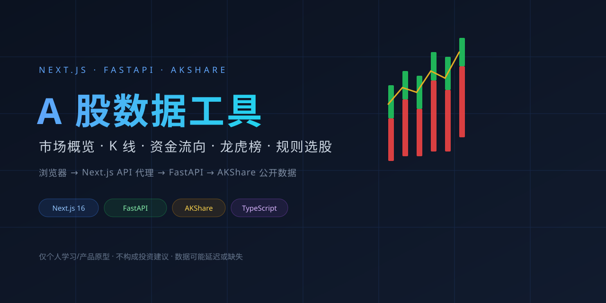
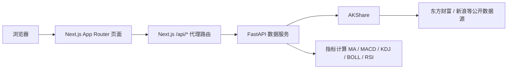

<p align="center">
  
</p>

<h1 align="center">A 股数据工具</h1>

<p align="center">
  一个 A 股行情与资金流看板原型：市场概览、K 线、资金流向、龙虎榜/涨停复盘、规则选股。
  <br />
  Next.js 前端 + FastAPI 数据服务，数据来自 AKShare 聚合的公开接口。
</p>

<p align="center">
  <a href="#快速开始"><strong>快速开始</strong></a> ·
  <a href="#架构">架构</a> ·
  <a href="#数据与限制">数据与限制</a> ·
  <a href="#license">License</a>
</p>

<p align="center">
  
  
  
  
  
</p>

> **定位**：个人学习与产品原型，不是实盘交易系统，不构成投资建议。数据可能延迟、缺失或被上游限流。

## 功能

| 页面 | 能做什么 |
| --- | --- |
| 市场概览 | 指数行情、涨停/跌停概况、连板梯队、热门行业、龙虎榜摘要 |
| K 线 | 股票搜索、日/周/月/分钟 K 线、MA/BOLL、MACD 副图 |
| 资金流向 | 北向资金趋势、行业/个股资金流、热力图 |
| 龙虎榜 | 龙虎榜列表、涨停梯队、行业分布 |
| 规则选股 | 均线多头 + 均线向上规则，异步任务 + 进度轮询（AI 概念股，最多 300 只） |

## 架构



前端不直接访问 Python 服务：浏览器请求同源的 `/api/*`，由 Next.js 服务端转发到 FastAPI。这样浏览器只需要一个地址，也方便以后把数据服务部署到单独机器。

## 快速开始

### 前置条件

- Node.js **20.9+**（Next.js 16 的要求）
- Python **3.10+**

### 1. 启动数据服务

```bash
cd data-service
python3 -m venv .venv
source .venv/bin/activate
pip install -r requirements.txt
uvicorn main:app --reload --port 8000
```

健康检查：<http://localhost:8000/health>

### 2. 启动前端

```bash
# 在项目根目录
npm install
npm run dev
```

打开 <http://localhost:3000>。

如果数据服务不在 `localhost:8000`：

```bash
# .env.local
PYTHON_API_URL=http://你的地址:8000
```

> 这个变量只在 Next.js 服务端读取，不要加 `NEXT_PUBLIC_` 前缀；参考 `.env.example`。

## 数据与限制

- 数据来自 **AKShare 聚合的第三方公开接口**，不是交易所直连；可能延迟、缺失、字段变更或被限流。
- 页面展示的是**最新可用数据**，不承诺“实时”。遇到周末/节假日/上游异常时，部分页面可能为空。
- 规则选股只覆盖 **AI 概念股，最多 300 只**，不是全市场扫描；规则是两条均线条件，不是 AI/机器学习选股。
- 龙虎榜席位明细、跌停家数等字段目前未完整接入；README 不把它们写成已有能力。
- 没有鉴权、限流和完整缓存治理，适合本地/演示环境，不建议直接暴露到公网。
- 数据仅用于学习与产品演示，**不构成任何投资建议**。

## 项目结构

```text
.
├── app/                    # Next.js 页面和 /api/* 代理路由
│   ├── page.tsx            # 市场概览
│   ├── kline/              # K 线
│   ├── capital-flow/       # 资金流向
│   ├── dragon-tiger/       # 龙虎榜 / 涨停复盘
│   ├── screener/           # 规则选股
│   └── api/                # 到 FastAPI 的服务端代理
├── components/             # 图表、表格、布局组件
├── lib/                    # API client、类型、格式化工具
├── data-service/           # FastAPI + AKShare
│   ├── routers/            # stock / capital / dragon_tiger / screener
│   └── services/           # 取数、指标计算、选股逻辑
├── docs/images/cover.svg   # README 封面
├── .env.example
└── LICENSE
```

## Roadmap

- [x] 市场概览 / K 线 / 资金流 / 龙虎榜 / 规则选股
- [x] Next.js 服务端代理到 FastAPI
- [ ] 统一代理层的超时、状态码和错误结构
- [ ] 交易日历（周末/节假日自动回退到最近交易日）
- [ ] 缓存与数据时间戳（TTL + “截至”展示）
- [ ] Docker Compose 一键启动
- [ ] 指标函数与数据转换的单元测试
- [ ] 移动端侧边栏抽屉与图表触摸交互

## License

[MIT](LICENSE)。AKShare 及其上游数据源有各自的使用条款，使用前请自行确认数据授权与合规要求。
